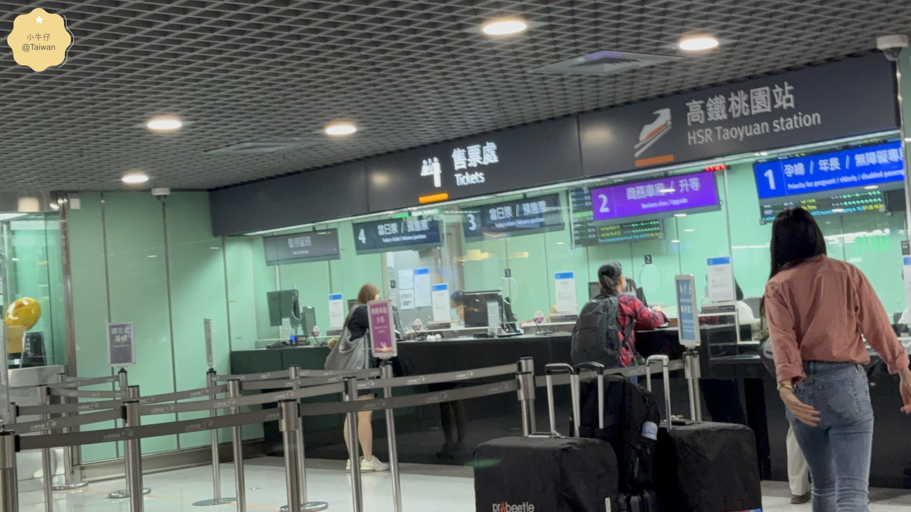

### 高鐵趴趴走，幫你省時+省錢？
搭高鐵出遊嗎？省時之外，有沒有省錢之道? 其實高鐵的優惠也很多，主要是搭配對的信用卡，最高有10%回饋，如果沒有高回饋的信用卡也沒關係，參考我們的高鐵刷卡回饋整理包，選一張手邊有的信用卡吧！

## 高鐵車票信用卡優惠攻略（一般車廂、商務車廂、自由座）

<!-- 直接嵌入主資料夾的互動頁面 -->

  <iframe src="https://littlecowboyuk.github.io/hsr-credit-card-ranking.html" 
          style="width: 100%; height: 650px; border: none; display: block;" 
          title="台鐵刷卡回饋排行榜">
  </iframe>

### 高鐵升等 商務車廂
*更多商務艙專屬服務與優惠新訊 請看：[高鐵升等商務艙攻略](https://s875261.pixnet.net/blog/post/578087634)*
*高鐵商務艙有什麼服務和免費茶點?? 請看下方實拍影片👇👇*

<a href="https://www.youtube.com/watch?v=QT8tyJcJ0EY" target="_blank" rel="noopener" class="yt-video-card-single">
  

    
    ▶️
  

  

    <strong style="color:#222; font-size:15px; display:block; margin-bottom:4px;">🎥 高鐵商務車廂實拍</strong>
    
專屬服務&amp;免費茶點！高鐵升等體驗！

  

</a>

## 結語

善用大眾交通優惠，幫自己節省旅費開支，省下的交通費還能買杯咖啡、小點心，愉快的享受一日美好的旅行。

---

> **完整文章：**  
> 高鐵完整攻略可參考 **[小牛仔痞客邦]([https://s875261.pixnet.net/blog](https://s875261.pixnet.net/blog/posts/9578087634))**。

  <!-- 影片 1 -->
  <a href="https://www.youtube.com/watch?v=Xj2CmZ2Q5A0" target="_blank" rel="noopener" class="yt-video-card">
    

      
      ▶️
    

    

      <h4 class="yt-card-title">🎥 苗栗景點懶人包</h4>
      
獅潭 → 泰安 → 大湖 → 三義 → 苗栗市山城慢旅

    

  </a>

  <!-- 影片 2 -->
  <a href="https://www.youtube.com/watch?v=-SF7pawyDUo" target="_blank" rel="noopener" class="yt-video-card">
    

      
      ▶️
    

    

      <h4 class="yt-card-title">🎥 金門美食3日遊</h4>
      
【金門離島系列】從早餐到宵夜在地小吃全推薦

    

  </a>

  <!-- 文章 1 -->
  <a href="https://s875261.pixnet.net/blog/posts/854287008627903201" target="_blank" rel="noopener" class="yt-video-card">
    

      
    

    

      <h4 class="yt-card-title">📍 全台吃到飽 優惠攻略</h4>
      
2026饗食天堂＋漢來海港＋星級知名 Buffet

    

  </a>

  <!-- 文章 2 -->
  <a href="https://s875261.pixnet.net/blog/posts/9578041474" target="_blank" rel="noopener" class="yt-video-card">
    

      
    

    

      <h4 class="yt-card-title">📍 饗食天堂 LaLaport 台中店</h4>
      
台中最大分店！無限美味自助餐吃到飽價格詳解

    

  </a>

  <!-- 文章 3 -->
  <a href="https://s875261.pixnet.net/blog/posts/9578069446" target="_blank" rel="noopener" class="yt-video-card">
    

      
    

    

      <h4 class="yt-card-title">📍 台中永豐棧酒店</h4>
      
高CP值便宜住宿推薦！近捷運＆YouBike、適合親子旅遊

    

  </a>

  <!-- 文章 4 -->
  <a href="https://s875261.pixnet.net/blog/posts/9577297708" target="_blank" rel="noopener" class="yt-video-card">
    

      
    

    

      <h4 class="yt-card-title">📍 台中旅遊｜鳳凰酒店</h4>
      
一次滿足住宿、娛樂和美食！星際樂園＋鳳凰食號優惠！

    

  </a>

*( [小牛仔頻道](https://www.youtube.com/@%E5%B0%8F%E7%89%9B%E4%BB%94UK-q5j) 有最新生活玩樂分享，歡迎訂閱按讚！謝謝！💜)*
