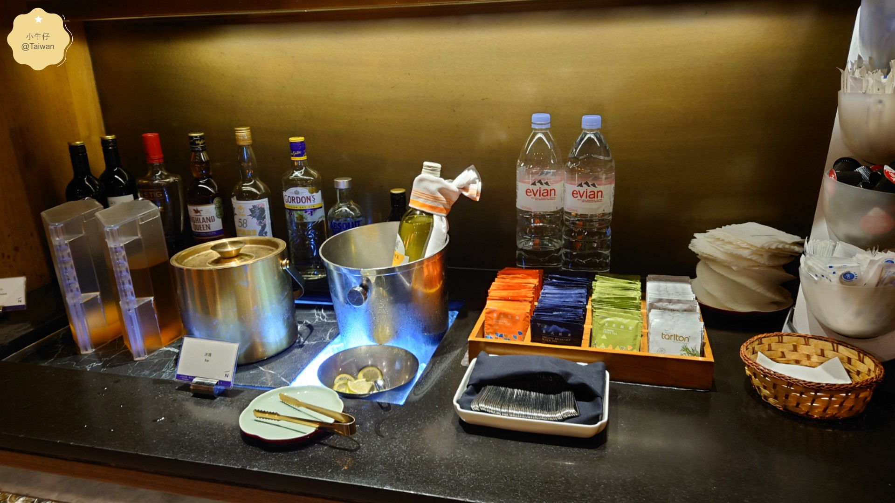

## 計劃在桃園機場貴賓室休息或品嚐美食嗎？

這篇整理**桃機中華航空貴賓室**相關資訊，在出發前參考最新的華航貴賓室攻略，能有個美好的機場體驗！

---

## ［桃機候機休息空間］

桃園國際機場（TPE）裡面有不少貴賓室選擇，不同旅客資格能進入的休息室也不一樣，對常搭華航的會員來說，最常去的就是華航自營貴賓室，裡面的設施和服務評價很好，如果有機會搭華航，要善加利用進貴賓室的機會喔！

(圖：桃園機場 華航貴賓室 / 好吃的現煮餐點)

---

## ［華航貴賓室 China Airlines］

<!-- 直接嵌入主資料夾的互動頁面 -->

  <iframe src="https://littlecowboyuk.github.io/china-airlines-lounge.html" 
          style="width: 100%; height: 650px; border: none; display: block;" 
          title="台鐵刷卡回饋排行榜">
  </iframe>

(圖：桃機華航貴賓室） （「飲酒過量，有害健康」)

---

*(如果文章有一點幫助，邀請您 按讚+訂閱 [小牛仔頻道](https://www.youtube.com/@%E5%B0%8F%E7%89%9B%E4%BB%94UK-q5j) ３Ｑ )*

---
> **延伸閱讀：**
> * [【桃園機場 環亞貴賓室】Plaza Premium Lounge](https://s875261.pixnet.net/blog/post/578056240)
> * [【各大航空哩程】星空聯盟/寰宇一家/天合聯盟 哩程賺分](https://s875261.pixnet.net/blog/posts/9578125362)
> * [【華航+KLM】機上餐食+華航貴賓室嚐鮮！](https://s875261.pixnet.net/blog/posts/9577178428)
> * [【華航金卡】金卡6個實用福利](https://s875261.pixnet.net/blog/posts/871758925790138347)
> * [【華航機票】優惠促銷活動＋聯名卡&酬賓機票](https://s875261.pixnet.net/blog/posts/881208669637660405)

### ［總結］
若是剛好搭華航，又有金卡以上資格，那麼就直接進華航貴賓室，不然也可以查詢哩程數，有沒有機會兌換貴賓室，都是不錯的喔！祝大家有美好的一天 ✈️

---

### 🎥 機場與各地旅遊｜影片精選

  <a href="https://www.youtube.com/watch?v=L_6ncG7sRHo" target="_blank" rel="noopener" class="yt-video-card">
    

      
      ▶️
    

    

      <h4 class="yt-video-title">KLM＋華航 飛行體驗</h4>
      
桃園機場華航貴賓室開箱

    

  </a>

  <a href="https://www.youtube.com/watch?v=pH2pjqEUddU" target="_blank" rel="noopener" class="yt-video-card">
    

      
      ▶️
    

    

      <h4 class="yt-video-title">桃園機場 貴賓室實拍</h4>
      
環亞貴賓室 餐點＋服務

    

  </a>

  <a href="https://www.youtube.com/watch?v=o2rsym4HEhk" target="_blank" rel="noopener" class="yt-video-card">
    

      
      ▶️
    

    

      <h4 class="yt-video-title">土耳其機場</h4>
      
伊斯坦堡轉機攻略

    

  </a>

  <a href="https://www.youtube.com/watch?v=UqZGCTDWDoY" target="_blank" rel="noopener" class="yt-video-card">
    

      
      ▶️
    

    

      <h4 class="yt-video-title">倫敦希思羅機場</h4>
      
第二航廈出入境實用資訊/機場攻略

    

  </a>

  <a href="https://www.youtube.com/watch?v=i6wK37J-w04" target="_blank" rel="noopener" class="yt-video-card">
    

      
      ▶️
    

    

      <h4 class="yt-video-title">台中饗食天堂</h4>
      
日式・中式・港式・鐵板 美食實拍

    

  </a>

  <a href="https://www.youtube.com/watch?v=NjhrmBABSq4" target="_blank" rel="noopener" class="yt-video-card">
    

      
      ▶️
    

    

      <h4 class="yt-video-title">台中永豐棧飯店</h4>
      
近捷運＆YouBike・價格便宜

    

  </a>

  <a href="https://www.youtube.com/watch?v=-Xj2CmZ2Q5A0" target="_blank" rel="noopener" class="yt-video-card">
    

      
      ▶️
    

    

      <h4 class="yt-video-title">苗栗旅遊懶人包</h4>
      
獅潭・泰安・大湖・三義慢旅

    

  </a>

  <a href="https://www.youtube.com/watch?v=afObj-nuBgc" target="_blank" rel="noopener" class="yt-video-card">
    

      
      ▶️
    

    

      <h4 class="yt-video-title">苗栗小吃懶人包</h4>
      
苗栗市11家銅板小吃

    

  </a>

### 📝 旅遊＆優惠｜文章精選
* [📌 金門懶人包 (Kinmen 3天2夜行程全攻略)](https://s875261.pixnet.net/blog/posts/868942441443443836)
* [📌 【華信航空】機票優惠全攻略 (最新折扣碼＋省錢小技巧)](https://s875261.pixnet.net/blog/posts/875767090978439234)
* [📌 苗栗聚餐總覽 (苗栗市、三義、後龍、竹南、頭份餐廳)](https://s875261.pixnet.net/blog/posts/889114011017104703)
* [📌 【信用卡餐廳優惠】 (全台飯店自助餐、吃到飽餐廳買一送一)](https://s875261.pixnet.net/blog/posts/879333489378283202)
